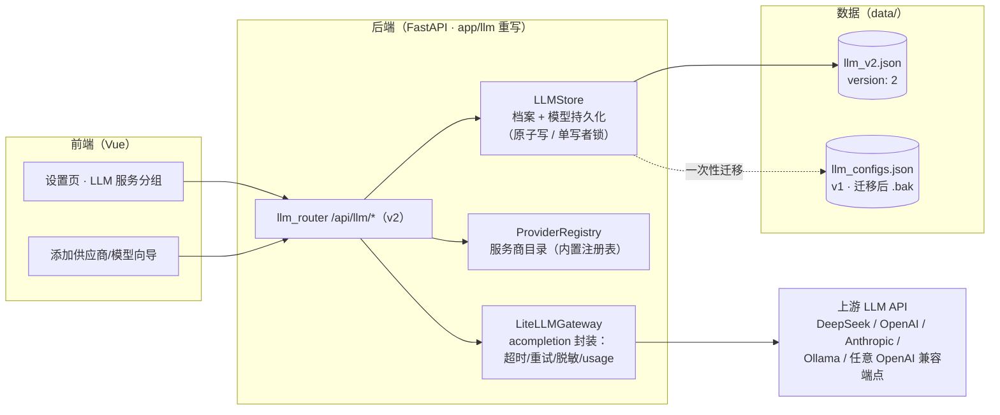
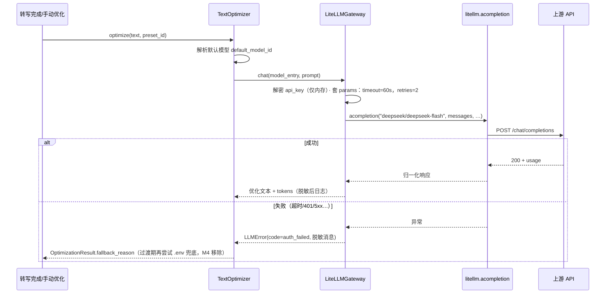
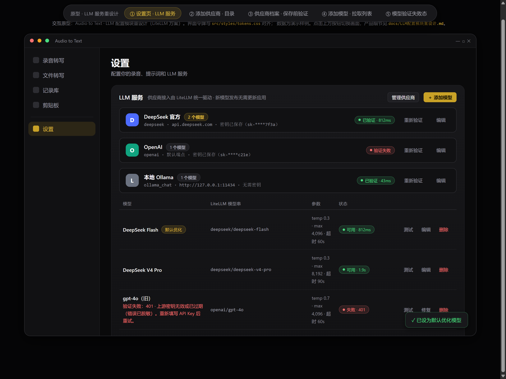
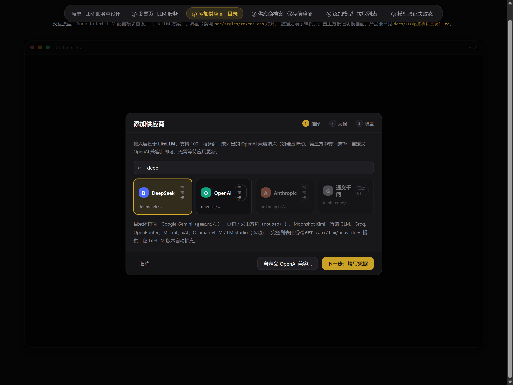
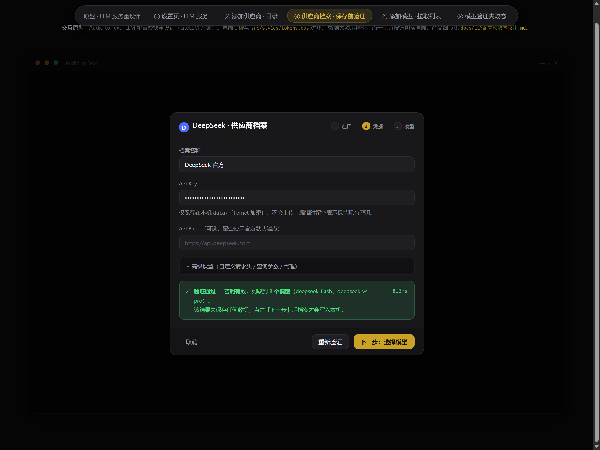
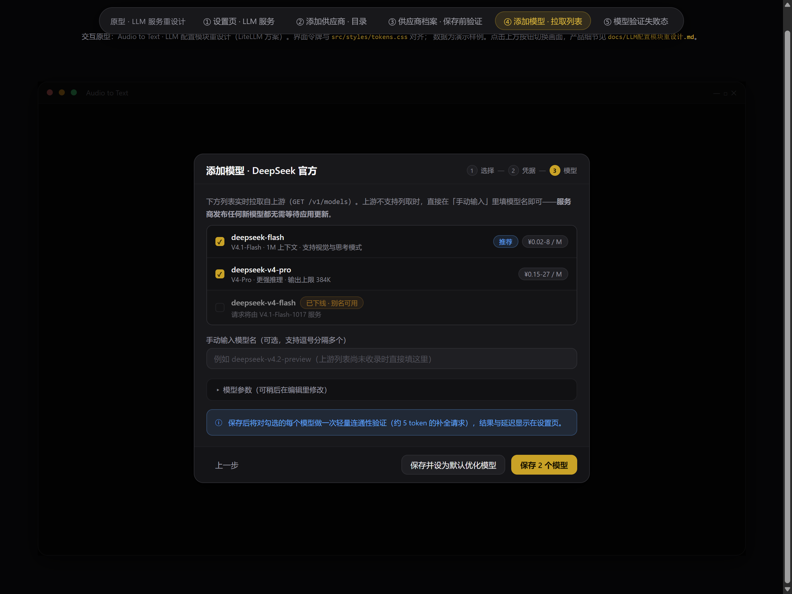
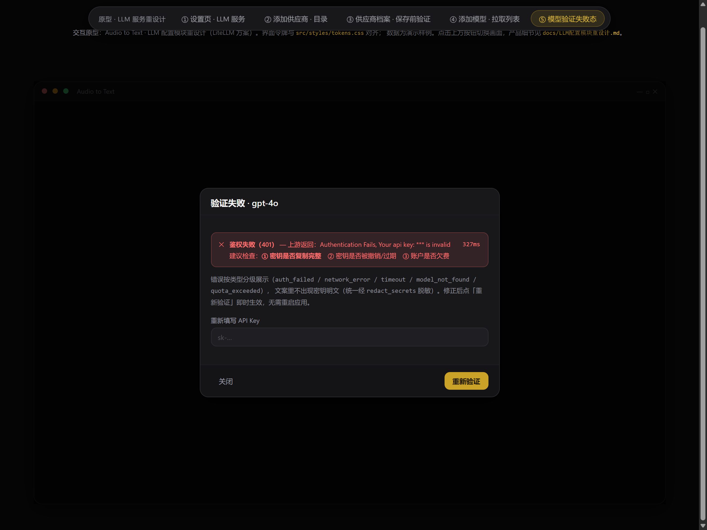

# LLM 配置模块重设计 · 产品文档

> 状态：**评审稿 v1**（2026-10-22）
> 范围：`app/llm/`、`app/api/routers/llm.py`、设置页 LLM 相关前端
> 关联：[已知问题](已知问题.md) #4（provider 无超时）、#9（配置全有或全无）
> 交互原型：[原型/llm-redesign.html](原型/llm-redesign.html)（浏览器直接打开，可点击切换画面）

---

## 1. 背景与问题

### 1.1 现状一句话

当前 LLM 模块是「**一个配置 = 一家服务商 + 一个写死的模型下拉**」的自研多 provider 实现：
五份几乎逐字重复的 provider 代码（`app/llm/providers/*.py`）+ 一份硬编码模型清单（`app/llm/models.py` 的 `PROVIDER_INFO`）。

### 1.2 证据：硬编码清单已经整体过时

DeepSeek 官方 API 现行模型（2026-10，[官方定价页](https://api-docs.deepseek.com/zh-cn/quick_start/pricing)）：

| 现行 API 模型名 | 对应版本 | 备注 |
| --- | --- | --- |
| `deepseek-flash` | DeepSeek-V4.1-Flash-1017 | 1M 上下文、支持视觉与思考模式 |
| `deepseek-v4-pro` | DeepSeek-V4-Pro-0813 | 输出上限 384K |

而应用里写死的是（`app/llm/models.py` 的 `PROVIDER_INFO`）：

| 应用硬编码 | 实际状态 |
| --- | --- |
| `deepseek-chat` / `deepseek-coder` | **deepseek-coder 早已下线**，deepseek-chat 亦不再是现行推荐名 |
| `claude-3-5-sonnet-20241022`、`claude-3-opus-20240229` | Anthropic 早已迭代多代 |
| `gpt-4o` / `gpt-4-turbo` / `gpt-3.5-turbo` | 同上 |
| `doubao-pro-32k` / `doubao-lite-32k` | 火山方舟现行以接入点 ID 为主 |

**这不是一次「更新清单」能解决的**：每家服务商的模型都在以月为单位迭代，硬编码清单从写下的那一刻就开始腐烂。

### 1.3 问题清单（按严重度）

| # | 问题 | 证据 | 影响 |
| --- | --- | --- | --- |
| P1 | 模型清单硬编码且过时，模型名只能从死下拉里选，**不能手输** | `PROVIDER_INFO`、LLMEditModal 的 `<BaseSelect>` | 新模型发布 → 应用里永远选不到，除非改代码发版 |
| P2 | 新增服务商要写代码：每家一个 provider 文件，gateway 里注册；OpenAI 兼容但没收录的（硅基流动、Groq、OpenRouter、本地 Ollama 等）全部接不了 | `app/llm/providers/` 五个文件约 90% 逐字重复 | 用户被锁死在 5 家内置服务商 |
| P3 | 优化请求**无超时**：SDK 客户端构造时没传 `timeout`，默认 600s | 已知问题 #4 | 网络黑洞时界面转圈最长 10 分钟，记录卡在 `optimizing` |
| P4 | 配置加载「全有或全无」：一条坏数据让全部 LLM 配置消失 | 已知问题 #9（`config_manager._load_configs`） | 用户视角「配置全丢了」 |
| P5 | 一个配置绑死一个模型：同一个 key 想用两个模型要**录两遍**、存两份密文 | `LLMConfig.model` 与配置一一绑定 | 密钥冗余，切换模型心智负担大 |
| P6 | 测试连接必须**先保存**才能测；草稿密钥没有验证入口 | `/llm/configs/{id}/test` 只接受已存 id | 配错只能保存后试错，失败状态无处展示 |
| P7 | 失败原因不分级：401 / 欠费 / 模型名错 / 超时全部一坨字符串 | `provider.test_connection()` 直接返回 `str(exc)` | 用户不知道该改什么 |
| P8 | 遗留双真相源：`.env` 的 `DEEPSEEK_*` 与 `data/llm_configs.json` 并存，优化器里还有一条绕过网关的直连降级路径 | `optimizer.py` 的 fallback 直连分支 | 配置不生效时静默走内置 key（2026-10 已加降级上报，但双源仍在） |
| P9 | Pydantic v1 风格 `class Config`（升级 Pydantic 3 会在 import 期崩掉整个后端） | 已知问题 #19 相关条目 | 技术债 |

### 1.4 机会

LLM 接入这件事已经被 [LiteLLM](https://docs.litellm.ai/docs/providers) 标准化了：**一套统一接口调 100+ 服务商**，
模型名 = `前缀/模型` 字符串，密钥、端点、超时、重试、错误格式全部归一。我们不该再维护自研协议适配层。

---

## 2. 目标与非目标

### 目标

1. **模型自由**：模型名可手输、可从上游实时拉取、可保存常用项；服务商发布新模型当天即可使用，**零发版**。
2. **服务商自由**：内置常见服务商目录（随 LiteLLM 自动扩充）；任何 OpenAI 兼容端点 3 分钟内接入，无需写代码。
3. **一次配置，多个模型**：密钥按「供应商档案」存一份，模型作为独立条目挂在其下，可随意增删。
4. **修掉 P3/P4/P6/P7**：全链路超时与重试可配；配置逐条容错加载；保存前即可验证；错误分级给可执行建议。
5. **安全不回退**：密钥 Fernet 加密存储、接口不回显、日志与错误文案统一脱敏（维持 AGENTS.md §3.4 硬约束）。
6. **平滑迁移**：v1 配置自动迁移，迁移失败可回滚，用户无感。

### 非目标

- 不做 LiteLLM **Proxy 网关服务**（见 §3.2），不引入虚拟密钥/团队/配额等团队功能。
- 不做多模型智能路由/负载均衡/成本核算面板（LiteLLM 有此能力，但 ATT 单机场景用不上；预留 `fallback_model_id` 一个字段即可）。
- 不在本期扩展 LLM 用途（目前唯一用途是「文本优化」；数据模型预留 `use_cases` 扩展位但不实现）。
- 不改提示词预设体系（`prompts/*.txt` 只读真相源不变）。

---

## 3. 方案选型

### 3.1 候选对比

| 方案 | 说明 | 结论 |
| --- | --- | --- |
| A. 继续自研，更新模型清单 | 治标：清单还会腐烂；新服务商仍要写代码 | 否决 |
| B. **LiteLLM Python SDK（进程内）** | `litellm.acompletion(model="deepseek/deepseek-flash", api_key=…, timeout=…)`，统一 100+ 服务商 | **采用** |
| C. LiteLLM Proxy（独立网关进程） | 需要额外进程 + 端口 + 配置文件，为团队场景设计 | 桌面单机场景过重 |

### 3.2 决策要点

- **SDK 模式**：ATT 是 Electron + FastAPI 桌面应用，LLM 调用方只有本进程的优化器。直接在 `app/llm/` 里调 `litellm.acompletion()`，不新增任何进程/端口。
- **轻量分发**：LiteLLM 官方提供独立的 `litellm-core` 发行版（同一 `import litellm` API，不带 proxy/CLI/dashboard 依赖），桌面场景优先用它；若当前版本不稳定则退回完整 `litellm` 包。
- **前缀是协议，不是清单**：`deepseek/deepseek-flash` 中前缀决定协议适配，斜杠后是**原样透传的模型名**——这就是「新模型零发版」的技术根据。
- **OpenAI 兼容兜底**：对 LiteLLM 尚未收录的服务商，统一走 `openai/<model>` + 自定义 `api_base`，产品层面保证「任何 OpenAI 兼容端点都能接」，不依赖逐家适配。
- **延迟导入**：`litellm` 首次 import 有可感开销，统一放进调用函数内部懒加载，避免拖慢后端启动（吸取 `TextOptimizer` 启动期构造 httpx 客户端被 SOCKS 代理环境搞挂的教训，见「已知问题」已修复表）。

---

## 4. 总体架构



- 旧五件套 provider（deepseek / openai / claude / doubao / qwen）**整体删除**，协议适配全部交给 LiteLLM。
- `LLMGateway` 重写为 `LiteLLMGateway`：不再是「造 SDK 客户端的工厂」，而是「acompletion 的统一调用点」——唯一注入超时/重试/脱敏/usage 归一的地方。
- 持久化继续走 `app/repositories/json_store.py` 的原子写与单写者锁（硬约束 §3.2/§3.3 不变）。

### 4.1 优化调用时序（唯一热路径）



---

## 5. 领域模型与数据结构

### 5.1 核心变化：配置从「一层」拆成「两层」

| v1（现） | v2（新） |
| --- | --- |
| `LLMConfig`：provider + key + model + 参数，四位一体 | `ProviderProfile`（档案：服务商 + 密钥 + 端点，**密钥只存这一份**）<br>`ModelEntry`（模型：litellm 模型串 + 参数，挂靠档案） |
| 默认 = 某条配置 | 默认 = `default_model_id` 指向某个模型条目；另留 `fallback_model_id`（默认空 = 失败不自动切换，避免意外费用） |

### 5.2 `data/llm_v2.json` 结构

```jsonc
{
  "version": 2,
  "profiles": [
    {
      "id": "prof-1761043200000",
      "provider": "deepseek",
      "name": "DeepSeek 官方",
      "api_key_encrypted": "gAAA…",
      "api_base": null,
      "extra_headers": {},
      "extra_query": {},
      "status": { "state": "ok", "checked_at": "2026-10-22T15:30:00", "latency_ms": 812, "error": null }
    }
  ],
  "models": [
    {
      "id": "mdl-1761043200111",
      "profile_id": "prof-1761043200000",
      "model": "deepseek/deepseek-flash",
      "display_name": "DeepSeek Flash",
      "params": {
        "temperature": 0.3,
        "max_tokens": 4096,
        "timeout_s": 60,
        "retries": 2
      },
      "use_cases": { "optimize": true },
      "status": { "state": "ok", "checked_at": "2026-10-22T15:30:05", "latency_ms": 812, "error": null, "error_code": null }
    }
  ],
  "default_model_id": "mdl-1761043200111",
  "fallback_model_id": null
}
```

字段要点：`provider` 是 LiteLLM 服务商前缀（见 §6.3 注册表）；`model` 是**原样透传**给 litellm 的模型串；
`api_base: null` 表示使用该前缀的默认端点；`params.timeout_s`/`retries` 每次请求强制注入（P3 修复）；
`use_cases` 为用途扩展位，本期恒为优化。

### 5.3 容错加载（P4 修复）

- 逐条解析：单条档案/模型字段非法 → **丢弃该条**并告警（结构化日志含条目 id），其余照常加载；界面顶部展示「N 条配置因数据损坏被跳过」。
- `default_model_id` 指向不存在的模型 → 自动回落到第一个可用模型并回写修正。
- 所有写入仍走 `write_json_atomic`，读取用 `read_json_lenient`。

---

## 6. 后端 API（v2）

统一前缀 `/api/llm`；除 `verify-draft` 场景外，密钥不出现于任何响应。

### 6.1 端点一览

| 方法 | 路径 | 说明 |
| --- | --- | --- |
| GET | `/api/llm/providers` | 服务商目录：id、名称、默认 base_url、是否需要密钥、常见模型建议、文档链接 |
| GET / POST | `/api/llm/profiles` | 档案列表 / 新建（POST 前端应先调 `verify-draft`） |
| GET / PUT / DELETE | `/api/llm/profiles/{id}` | 详情 / 更新 / 删除（删除级联其下模型；含默认模型时返回 409 引导先改绑） |
| POST | `/api/llm/profiles/{id}/verify` | 已存档案验证：鉴权 + 列取上游模型 |
| POST | `/api/llm/profiles/{id}/remote-models` | 拉取上游模型列表（OpenAI 兼容 `/v1/models`；不支持返回 409 + `manual_only: true`） |
| POST | `/api/llm/verify-draft` | **保存前验证**：接收草稿参数，密钥仅在内存中使用后即弃，不落盘（P6 修复） |
| GET / POST | `/api/llm/models` | 模型列表 / 批量新建（支持一次勾选多个） |
| PUT / DELETE | `/api/llm/models/{id}` | 更新 / 删除（默认模型删除返回 409） |
| POST | `/api/llm/models/{id}/verify` | 单模型轻量验证（max_tokens≈5 的补全，超时 15s） |
| POST | `/api/llm/models/{id}/activate` | 设为默认优化模型 |
| PUT | `/api/llm/settings` | `default_model_id` / `fallback_model_id` |

### 6.2 验证结果结构（全部验证类端点统一）

```jsonc
{
  "ok": true,
  "error_code": null,
  "message": null,
  "latency_ms": 812,
  "remote_models": ["deepseek-flash", "deepseek-v4-pro"]
}
```

`error_code` 取值：`ok | auth_failed | model_not_found | quota_exceeded | timeout | network_error | provider_error`；
`message` 是已脱敏、已翻译为中文建议的文案。错误分级 → 前端建议映射（P7 修复）：

| error_code | 判定 | 界面建议 |
| --- | --- | --- |
| `auth_failed` | 401/403 | 检查密钥是否复制完整、是否被撤销/过期、账户是否欠费 |
| `model_not_found` | 404 或错误体含 model | 模型名是否正确（含服务商前缀）；尝试从列表重新拉取 |
| `quota_exceeded` | 429/余额类 | 账户欠费或触发限流，稍后重试或充值 |
| `timeout` | 超时异常 | 端点不可达或过慢，检查网络/代理，或在参数里调大超时 |
| `network_error` | 连接类异常 | 检查网络与代理设置 |
| `provider_error` | 5xx | 上游故障，稍后重试 |

### 6.3 服务商注册表（`GET /api/llm/providers` 数据源）

内置注册表只存「**协议前缀 + 元信息**」，不存模型清单（这是与 v1 的本质区别）：

| 注册 id | LiteLLM 前缀 | 默认端点 | 需密钥 |
| --- | --- | --- | --- |
| deepseek | `deepseek/` | `https://api.deepseek.com` | 是 |
| openai | `openai/` | `https://api.openai.com/v1` | 是 |
| anthropic | `anthropic/` | `https://api.anthropic.com` | 是 |
| gemini | `gemini/` | Google AI Studio | 是 |
| dashscope（通义千问） | `dashscope/` | 阿里云百炼 | 是 |
| doubao（豆包/火山方舟） | `doubao/`（版本未收录时自动回退 `openai/` + 端点） | 火山方舟 | 是 |
| moonshot / zhipu / groq / mistral / xai / openrouter | 各自前缀 | — | 是 |
| ollama | `ollama_chat/` | `http://127.0.0.1:11434` | 否 |
| custom | `openai/` + 用户 `api_base` | — | 可选 |

> 注：各前缀的可用性以锁定版本的 LiteLLM 实际支持列表为准；**未被收录的服务商走 custom（`openai/` + base_url）兜底，功能不缺失**。

### 6.4 v1 端点处置

- `/api/llm/configs*` 保留**一个过渡版本**：读端点内部映射为 v2 视图；写端点返回 `410 Gone` + 引导文案（防止旧前端双写）。
- M2 前端切换完成、M4 清理时整体删除，同时删除 `PROVIDER_INFO`。

---

## 7. 前端交互设计

设置页新增「LLM 服务」分组，取代现「默认 LLM 配置」下拉 + 管理弹窗（`LLMModal` / `LLMEditModal` 下线）。

### 7.1 画面一览（截图来自 [原型/llm-redesign.html](原型/llm-redesign.html)，可交互）

**① 设置页 · LLM 服务分组**——供应商档案卡（状态徽章 + 最近验证延迟）+ 模型表（默认徽章、模型串、参数摘要、逐模型状态与失败原因内联展示）：



**② 添加供应商 · 目录选择**——服务商目录带搜索，明确提示「未列出的 OpenAI 兼容端点走自定义」：



**③ 供应商档案 · 保存前验证**——密钥保存前先验证；验证通过展示列取到的模型数与延迟（P6 修复）：



**④ 添加模型 · 拉取列表**——实时拉取上游模型列表勾选，同时提供手动输入兜底（P1 核心解法）：



**⑤ 验证失败态**——错误分级 + 可执行建议 + 密钥脱敏展示（P7 修复）：



### 7.2 交互规则

1. **向导三步**：选服务商 → 填凭据（立即验证）→ 选模型（拉取 + 手输）→ 保存。任何一步失败可重试，不产生脏数据。
2. **模型名手输是一等公民**：手输名与拉取名走同一 `ModelEntry` 存储，保存时自动做一次轻量验证。
3. **默认模型切换**：模型行「设为默认」即时生效（`POST /activate`），Toast 反馈；下一次优化请求即用新模型，无需重启。
4. **失败可见性**：档案/模型卡片常驻最近一次验证状态；优化运行时失败沿用既有 WS `optimization_degraded` 通道提示。
5. **密钥展示**：一律 `sk-****后四位`；「已保存」状态而非回显；编辑留空 = 保持现有密钥。
6. 前端对外部能力的访问继续只走 `src/api/client.js`（硬约束 §3.7），新增 llmV2 命名空间方法。

---

## 8. 安全设计（全部为既有硬约束的延续）

| 项 | 策略 |
| --- | --- |
| 存储 | 密钥 Fernet 加密（`api_key_encrypted`），密钥文件 `data/.encryption_key` 不变；档案级存一份，模型条目不存密钥 |
| 接口 | 任何响应不含密钥明文；档案详情只返回 `api_key_set: true` + 掩码尾号 |
| 日志/错误 | 所有对外文案过 `app/llm/security.py` 的 `redact_secrets`（401 回显密钥的坑已验证存在） |
| verify-draft | 草稿密钥仅存于请求处理期间内存，验证完成即弃，不写任何文件 |
| 本地模型 | Ollama 等无密钥档案允许 `api_key_encrypted` 为空 |

---

## 9. 迁移方案

### 9.1 数据迁移（一次性、可回滚）

1. 首次启动 v2 后端时检测 `data/llm_configs.json`（v1）：
   - 按「provider + 解密后 key + api_base」聚合为 `ProviderProfile`（同 key 多配置只存一份密文）；
   - 每条 v1 配置生成一个 `ModelEntry`（`model` 补全前缀：v1 的 `deepseek` → `deepseek/<model>`）；
   - `default_config_id` 映射到对应 `ModelEntry.id`；
   - 成功后 v1 文件原地改名为 `llm_configs.json.v1.bak`（保留回滚锚点），v2 写入 `llm_v2.json`；
   - 单条迁移失败：跳过该条并在设置页提示「1 条旧配置无法自动迁移」，其余照常。
2. 回滚：还原 `.bak` 文件名 + 启动 v1 后端即可，v2 不删 v1 原文件内容。
3. 解密失败的旧条目（换机器/丢 keyring）：保留原密文字段并标记 `status=decrypt_failed`，允许用户重填 key 修复，而不是整条丢弃。

### 9.2 `.env` 兜底处置（P8）

- 过渡期保留现有「用户配置失败 → 内置 key 兜底 + `fallback_reason` 上报」行为（2026-10 已修复的静默降级不回退）。
- M4：删除 `Settings` 的 `deepseek_*` 字段与优化器直连路径，`.env` 相关变量在配置说明里标注废弃。

### 9.3 里程碑

| 阶段 | 内容 | 出口条件 |
| --- | --- | --- |
| M0 | 引入 `litellm-core`（或 `litellm`，锁版本）、服务商注册表数据 | `uv sync` 通过；打包清单验证依赖体积可接受（关联已知打包问题） |
| M1 | 后端：`LLMStore` + 迁移器 + v2 API（v1 保留） | pytest 契约/迁移/脱敏用例全绿；v1 数据迁移自测通过 |
| M2 | 前端：设置页 LLM 分组 + 三步向导，切换 v2 API | Node 逻辑用例全绿；原型交互全部可走通 |
| M3 | 优化器切 `LiteLLMGateway`；删除五个 provider 文件与 gateway 工厂 | 全链路超时生效（≤ 配置值）；现有 268 用例不回归 |
| M4 | 删 v1 API、`.env` 兜底、`PROVIDER_INFO`；更新 docs | `docs/已知问题.md` 关闭 #4/#9；文档索引更新 |

> 人日为估算参考：M0 0.5d · M1 2d · M2 2.5d · M3 1d · M4 0.5d。

---

## 10. 测试策略

| 层 | 内容 |
| --- | --- |
| pytest | ① 迁移器：v1 样例→v2、坏条目跳过、默认映射、解密失败保留 ② API 契约：新增端点参数/错误码 ③ `LiteLLMGateway`：monkeypatch `acompletion` 验证超时/重试参数注入、错误分级映射、脱敏 ④ 容错加载：单条损坏不影响其余 |
| Node（`scripts/run-node-tests.mjs`） | 设置页表单逻辑与模型选择逻辑抽到纯 `.mjs`（遵循硬约束 §3.8）：默认模型切换守卫、手输模型名校验、错误码→文案映射 |
| 手动验收 | DeepSeek 手输新模型名端到端优化成功；Ollama 本地模型接入；断网时 60s 内失败并给出 timeout 文案；迁移回滚演练 |

---

## 11. 验收标准

1. **零发版接新模型**：服务商发布新模型当天，用户手输/拉取即可在优化中使用（演示：手输一个未收录的模型名并完成一次优化）。
2. **3 分钟接任意 OpenAI 兼容端点**：走 custom 档案，从新建到优化成功。
3. **超时生效**：模拟网络黑洞，优化请求在配置超时（默认 60s）内失败并给出分级提示；不再出现 10 分钟挂起（关闭已知问题 #4）。
4. **局部损坏不扩散**：手工构造一条坏配置，其余配置正常加载并提示（关闭已知问题 #9）。
5. **安全回归**：全链路（存储/接口/日志/错误文案）无密钥明文。
6. **迁移无损**：v1 用户升级后模型与默认设置语义等价，可回滚。

---

## 12. 风险与开放问题

| 风险 | 应对 |
| --- | --- |
| `litellm` 依赖较重，影响安装包体积（叠加已知 `--win` 打包问题） | 优先 `litellm-core` 轻量分发；M0 就验证打包清单；延迟导入不影响启动 |
| LiteLLM 迭代快，个别前缀行为漂移（如 doubao） | 锁定版本；注册表内标注「版本未收录时回退 openai/ + base_url」的自动兜底；契约测试覆盖关键前缀 |
| 部分上游无 `/v1/models` 列取能力 | `remote-models` 返回 409 + `manual_only`，前端引导手输（已是产品内一等路径） |
| 手输名打错导致用户困惑 | 保存即验证 + `model_not_found` 分级建议；不做「模型名合法性猜测」 |
| tokens/usage 各家形状不一 | 直接使用 LiteLLM 归一化后的 `usage`，优化结果开始回填真实 `tokens_used`（现恒为 0） |

**开放问题（评审时定）**：

1. `fallback_model_id` 是否本期开放 UI？（数据结构先留，UI 可后置）
2. 记录详情页是否展示本次优化所用模型/耗时/费用估算？（依赖 usage 回填，建议 M4 后独立小迭代）
3. `verify-draft` 是否需要防滥用限流？（本地单机，倾向不做，仅超时 15s）
