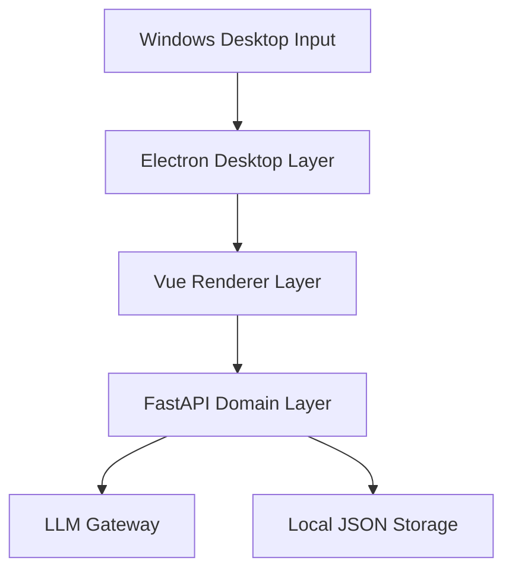

# AI 划词动作中心产品设计文档

## 1. 文档信息

- 文档日期：2026-03-30
- 文档状态：待评审
- 目标版本：V1
- 适用平台：Windows 桌面优先
- 关联系统：Electron Main + Vue Renderer + FastAPI Backend

## 2. 产品概述

`AI 划词动作中心` 是集成在 ATT 现有桌面系统中的一项 AI Native 能力。用户在任意应用中选中文本后，系统在鼠标附近弹出轻量工具条，默认提供 `翻译` 动作，并支持扩展为 `解释`、`总结`、`改写`、`继续追问` 等 AI 动作。所有发生过查询的外语词、短语、句子都会自动沉淀到个人生词本，形成持续积累的专属语言资产。

该功能不是单独的翻译模块，而是一个统一的桌面级文本理解入口。翻译是最高频默认动作，词库沉淀是长期价值，AI 动作扩展是未来增长空间。

## 3. 设计目标

### 3.1 核心目标

1. 在桌面环境中实现接近“划词即得”的低摩擦体验。
2. 优先保证翻译与解释质量，能力底座统一走 LLM。
3. 尽量复用现有 Electron、Vue、FastAPI、LLM 配置和本地 JSON 存储体系。
4. 自动沉淀生词与查询历史，为后续复习、Agent 办公动作、知识资产管理做准备。

### 3.2 非目标

1. V1 不追求所有 Windows 应用 100% 一致兼容。
2. V1 不做浏览器插件主入口。
3. V1 不做 OCR 截图翻译。
4. V1 不做复杂复习算法、记忆曲线、背单词训练营。
5. V1 不新增独立翻译模型，翻译与其他动作统一走 LLM。

## 4. 用户价值与使用场景

### 4.1 用户价值

- 遇到生词时无需手动复制粘贴，不跳出当前阅读场景。
- 不必打开专门的翻译或背词软件，网页、新闻、PDF、聊天内容都可以顺手学习。
- 同一次查询即可拿到翻译、解释和更多 AI 动作，不再拆多个工具链。
- 所有查过的内容自动沉淀为生词本，形成个人词库。

### 4.2 典型场景

1. 用户在浏览器阅读英文新闻，划中一个单词，点击 `翻译`，立即看到主译义和词性，并自动加入生词本。
2. 用户在 PDF 中划中一整句，点击 `解释`，获得上下文语义说明。
3. 用户在聊天工具中选中一段外语内容，点击 `总结`，快速理解重点。
4. 用户在文档工具中选中一段说明，点击 `改写`，生成更适合写作场景的表达。

## 5. 产品原则

### 5.1 轻入口

主入口必须是鼠标附近的轻工具条，而不是重面板。用户不应被迫切换到主窗口，也不应先进入剪贴板历史页。

### 5.2 准确优先

翻译与解释质量优先于极致低延迟。允许适度等待，以换取更稳定、可用、可信的结果。

### 5.3 分层兼容

跨应用能力通过多层获取选区方案实现，而不是假设单一路径可覆盖全部应用。

### 5.4 自动沉淀

所有查询过的文本自动进入词库或动作历史，减少手动收藏成本。

### 5.5 统一能力底座

翻译、解释、总结、改写统一走 LLM 网关编排，不额外引入独立翻译模型。

## 6. 范围定义

### 6.1 V1 范围

- 桌面级选中文本触发
- 鼠标附近轻工具条
- 默认 `翻译` 动作
- `解释 / 总结 / 改写` 扩展动作
- 结果卡片
- 自动生词本
- 生词本页面
- 设置页中的 AI 动作中心配置

### 6.2 V1.5 范围

- 继续追问
- 查询历史页
- 词条详情页增强
- 例句增强
- 来源上下文回看

### 6.3 V2 范围

- OCR 截图翻译
- 图片选区翻译
- 词条聚类与复习计划
- 发音与 TTS
- 浏览器插件桥接
- Agent 办公动作扩展

## 7. 信息架构

```text
桌面划词
  -> 轻工具条
    -> 翻译
    -> 解释
    -> 总结
    -> 改写
    -> 更多
  -> 结果卡片
    -> 自动加入生词本
    -> 收藏
    -> 查看例句
    -> 继续提问

主应用
  -> 生词本页面
  -> AI 动作历史（后续）
  -> 设置页 / AI 动作中心
```

## 8. 外观设计

### 8.1 整体视觉方向

延续当前系统已有的桌面工具视觉语言，不另起一套风格。建议采用 `深色轻工具条 + 浅色结果卡片 + 主应用深色管理页` 的组合，保持与现有剪贴板悬浮窗、浮动状态窗、设置页之间的视觉一致性。

推荐气质：

- 稳定、专业、桌面感强
- 不走传统词典产品的厚重风格
- 不走网页插件式轻飘感
- 保持“系统级 AI 工具”的可信度

### 8.2 轻工具条设计

#### 目标

在用户选中文本后快速出现，表达“此处可以立刻做 AI 动作”。

#### 视觉要求

- 宽度建议：280 到 360px
- 高度建议：44 到 64px
- 圆角、阴影、轻微悬浮感
- 默认展示 4 到 6 个动作
- 默认高亮 `翻译`
- 应支持键盘操作与 Esc 关闭

#### 建议动作排布

- `翻译`
- `解释`
- `总结`
- `改写`
- `更多`

### 8.3 结果卡片设计

#### 目标

在轻工具条触发后承载主要结果，既要足够轻，又要能体现“准确优先”的内容密度。

#### 信息优先级

1. 原词或原句
2. 主翻译结果
3. 词性或简要解释
4. 是否已加入生词本
5. 继续动作：收藏、例句、继续提问

#### 展示策略

- 对单词：优先展示译义、词性、简短解释
- 对短语：优先展示意译和常见用法
- 对句子：优先展示整句翻译和上下文解释

### 8.4 生词本页面设计

#### 目标

承接“自动沉淀”的长期价值，让用户可以回看、搜索、收藏、筛选。

#### 页面结构

1. 顶部统计区
   - 今日新增
   - 累计词条
   - 收藏词条

2. 中部列表区
   - 支持 `单词 / 短语 / 句子`
   - 支持搜索、收藏筛选、最近查询

3. 详情区
   - 基本释义
   - 查询来源
   - 上下文
   - AI 解释
   - 例句

## 9. 交互设计

### 9.1 主流程

```text
用户划词
  -> 系统检测有效选区
  -> 鼠标附近弹出轻工具条
  -> 用户点击翻译
  -> 展示结果卡片
  -> 自动写入生词本与动作历史
  -> 用户可继续解释 / 总结 / 改写 / 收藏
```

### 9.2 触发逻辑

为兼顾跨应用体验与稳定性，采用三层触发策略：

1. 直接读取选区
2. 复制回退读取
3. 回退到当前剪贴板翻译

### 9.3 误触控制

- 选区长度需满足最小阈值
- 完成选区后延迟 150 到 300ms 再触发
- 对同一文本短时间内避免重复弹出
- 特殊输入框场景允许禁用或降级

### 9.4 关闭策略

- 点击外部关闭
- Esc 关闭
- 连续查询时更新内容，不反复重建窗口
- 后续支持固定到侧边查看

## 10. 架构设计

### 10.1 总体分层



### 10.2 Electron Desktop Layer

职责：

- 全局鼠标与键盘监听
- 判断选区动作是否完成
- 获取鼠标锚点位置
- 尝试读取选中文本
- 失败时执行复制回退
- 管理轻工具条与结果卡片窗口
- 在需要时执行粘贴回填

设计原则：

- 桌面级入口必须放在 Electron 层
- 不把跨应用选区兼容逻辑下沉到 Vue 或 FastAPI

### 10.3 Vue Renderer Layer

职责：

- 展示轻工具条
- 展示结果卡片
- 展示生词本页面
- 展示设置页中的 AI 动作中心配置

设计原则：

- 延续当前 Vue 3 + Pinia 体系
- 不新增额外 UI 框架

### 10.4 FastAPI Domain Layer

职责：

- 编排翻译、解释、总结、改写等动作
- 管理结果缓存
- 管理生词本与动作历史
- 管理词条统计与查询

设计原则：

- 所有 AI 动作通过统一领域服务完成
- 所有能力通过现有 LLM 配置体系调用

### 10.5 LLM Gateway

职责：

- 统一接入在线 LLM
- 根据动作类型路由提示词模板
- 输出结构化结果

设计原则：

- 翻译与其他动作统一走 LLM
- 不单独引入独立翻译模型
- 通过结构化 schema 约束输出，降低前端解析成本

### 10.6 Local JSON Storage

沿用现有系统的本地 JSON 管理模式，新增目录建议如下：

```text
data/
  wordbook/
  ai_actions/
  translation_cache/
```

## 11. 技术选型

### 11.1 桌面能力

- `Electron`：继续作为桌面宿主
- 旧全局输入实现：继续作为全局键鼠监听基础
- `Windows 选区分层兼容方案`：直接读取选区优先，复制回退兜底

说明：

- 旧全局输入实现适合监听输入，不适合单独承担选区读取
- V1 应采用多路径兼容，而不是依赖单一库

### 11.2 前端

- `Vue 3`
- `Pinia`
- 现有窗口与路由体系

### 11.3 后端

- `FastAPI`
- 现有 `app/llm/` 作为统一 LLM 能力出口

### 11.4 数据存储

- V1 继续使用本地 JSON
- 当后续搜索、复习、同步需求增强时，再考虑 SQLite

## 12. 数据模型设计

### 12.1 生词条目模型

建议字段：

```json
{
  "id": "uuid",
  "source_text": "accurate",
  "normalized_text": "accurate",
  "language": "en",
  "entry_type": "word",
  "translation": "准确的；精确的",
  "explanations": [
    "adj. correct and exact in every detail"
  ],
  "examples": [],
  "source_app": "chrome.exe",
  "source_context": "The report is accurate and concise.",
  "query_count": 3,
  "is_favorite": false,
  "metadata": {},
  "first_seen_at": "2026-03-30T13:00:00",
  "last_seen_at": "2026-03-30T13:10:00"
}
```

### 12.2 AI 动作历史模型

建议字段：

- `id`
- `action_type`
- `source_text`
- `result_summary`
- `source_app`
- `created_at`
- `metadata`

## 13. 推荐目录结构

```text
electron/
  selectionCapture/
  selectionToolbar/

src/components/
  selection/
  wordbook/

app/
  ai_actions/
  wordbook/
```

说明：

- 不建议把该功能直接并入 `clipboard/`
- 不建议把该功能直接并入 `records/`
- 它应作为独立领域存在，但可与剪贴板、设置、LLM 配置联动

## 14. API 设计

### 14.1 AI 动作接口

- `POST /api/ai-actions/translate`
- `POST /api/ai-actions/explain`
- `POST /api/ai-actions/rewrite`
- `POST /api/ai-actions/summarize`
- `POST /api/ai-actions/chat`

### 14.2 生词本接口

- `GET /api/wordbook`
- `POST /api/wordbook`
- `PUT /api/wordbook/{id}`
- `GET /api/wordbook/stats`

### 14.3 translate 返回结构建议

```json
{
  "source_text": "accurate",
  "normalized_text": "accurate",
  "translation": "准确的；精确的",
  "detected_language": "en",
  "entry_type": "word",
  "explanations": [
    "adj. correct and exact in every detail"
  ],
  "examples": [],
  "saved_to_wordbook": true,
  "wordbook_entry_id": "uuid"
}
```

## 15. 设置页扩展建议

在现有设置页中新增 `AI 动作中心` 分组，建议配置项：

- 启用桌面划词动作中心
- 默认动作
- 触发延迟
- 是否自动加入生词本
- 是否展示例句
- 是否记录来源上下文
- 失败时是否回退到翻译当前剪贴板
- AI 动作提示词模板选择

## 16. 集成策略

### 16.1 与现有系统的复用关系

1. 复用 Electron 全局输入监听能力
2. 复用悬浮窗与浮层管理模式
3. 复用 preload + HTTP API 调用模式
4. 复用现有 LLM 配置体系
5. 复用本地 JSON 数据管理习惯

### 16.2 为什么不直接复用剪贴板悬浮窗

虽然该功能与剪贴板链路有关，但两者语义不同：

- 剪贴板悬浮窗：历史调取
- AI 划词动作中心：即时理解

因此两者应共享底层能力，但不应共享主交互入口。

## 17. 风险与应对

### 17.1 跨应用兼容性风险

风险：

- 不同应用对选区暴露方式不同

应对：

- 采用分层兼容
- 在产品上明确回退策略

### 17.2 误触风险

风险：

- 用户只是普通选择文本，不一定希望出现工具条

应对：

- 增加停顿阈值、长度阈值、去重策略

### 17.3 LLM 成本与延迟

风险：

- 统一走 LLM 可能带来更高成本与更长等待

应对：

- 做文本缓存
- 做动作级缓存
- 输出结构化精简结果

### 17.4 数据规模增长

风险：

- 生词本和动作历史规模变大后，JSON 检索性能下降

应对：

- V1 先使用 JSON
- 后续在规模达到阈值后切换 SQLite

## 18. 版本规划

### 18.1 V1

- 桌面级划词触发
- 轻工具条
- 翻译
- 解释 / 总结 / 改写
- 结果卡片
- 自动生词本
- 生词本页面

### 18.2 V1.5

- 继续追问
- 查询历史
- 详情页增强
- 来源上下文回看

### 18.3 V2

- OCR
- 图片翻译
- 复习计划
- 发音
- 浏览器插件桥接
- Agent 办公动作

## 19. 结论

`AI 划词动作中心` 适合作为 ATT 在现有语音转写与剪贴板能力之外的第二个高频入口。它既能扩展产品在外语学习场景下的使用频率，也能为后续 AI 办公动作中心奠定统一入口。该方案在技术上不需要推翻现有系统，只需在 Electron 增加桌面级选区入口，在 Vue 增加浮层和词库页面，在 FastAPI 增加 AI 动作与词库领域服务，即可形成一条完整的新能力链路。
