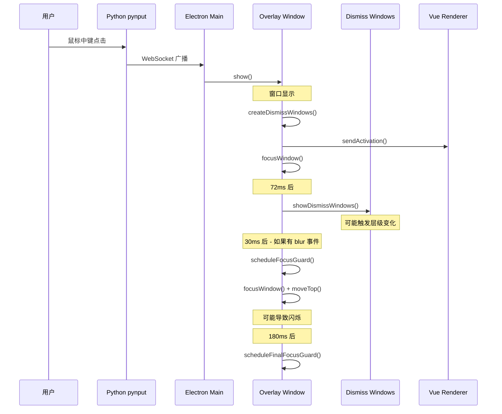

# BUG 报告：剪切板悬浮框内容闪烁问题

## 问题描述

**症状**：鼠标中键点击触发剪切板悬浮框后，悬浮框内容（列表项）在显示后短暂延迟开始闪烁。

**复现条件**：
- 第一次打开不闪烁
- 第二次及后续打开都会闪烁
- 每次都稳定复现

**影响**：用户体验受影响，悬浮框内容闪烁让用户感觉应用不稳定。

## 根本原因分析

### 时序分析



### 问题点 1：dismiss windows 显示时机

**文件**：[`electron/clipboardOverlay/index.js:609-623`](electron/clipboardOverlay/index.js:609)

```javascript
showDismissWindows() {
  if (this.pinned || this.dismissWindows.length === 0) {
    return
  }

  for (const item of this.dismissWindows) {
    item.window.showInactive()
  }

  // 不再调用 moveTop()，避免影响主窗口层级导致闪烁
  logElectronOverlay('overlay-manager', 'Showing dismiss windows', {
    count: this.dismissWindows.length,
    slots: this.dismissWindows.map((item) => item.slot)
  })
}
```

虽然已经移除了 `moveTop()` 调用，但 `showInactive()` 仍然可能影响窗口层级。

### 问题点 2：焦点守卫的重复调用

**文件**：[`electron/clipboardOverlay/index.js:92-104`](electron/clipboardOverlay/index.js:92)

```javascript
this.window.on('blur', () => {
  const now = Date.now()
  
  if (now < this.ignoreBlurUntil) {
    // 在焦点保护期内收到 blur，只调度一个焦点守卫，减少闪烁
    this.scheduleFocusGuard('blur-grace', 30, this.showSequence)
    return
  }
  // ...
})
```

**文件**：[`electron/clipboardOverlay/index.js:519-549`](electron/clipboardOverlay/index.js:519)

```javascript
focusWindow(reason) {
  // ...
  this.window.setAlwaysOnTop(true, 'screen-saver')
  this.window.moveTop()  // 可能导致闪烁
  this.window.focus()
  this.window.webContents.focus()
}
```

当 dismiss windows 显示时，可能会触发主窗口的 `blur` 事件，导致 `focusWindow()` 被调用，其中的 `moveTop()` 可能会导致窗口闪烁。

### 问题点 3：窗口复用时的状态残留

**文件**：[`electron/clipboardOverlay/index.js:26-33`](electron/clipboardOverlay/index.js:26)

```javascript
createWindow() {
  if (this.window) {
    logElectronOverlay('overlay-manager', 'Reusing existing overlay window', {
      isVisible: this.isVisible,
      isReady: this.isReady
    })
    return this.window  // 复用现有窗口
  }
  // ...
}
```

**文件**：[`src/components/clipboard/ClipboardOverlayWindow.vue:179-209`](src/components/clipboard/ClipboardOverlayWindow.vue:179)

```javascript
async function loadItems() {
  // 如果已经有数据，不显示加载状态，静默更新，避免闪烁
  const hasExistingItems = items.value.length > 0
  if (!hasExistingItems) {
    isLoading.value = true
  }

  try {
    items.value = await api.getClipboardItems({
      query: query.value.trim(),
      limit: 30
    })
    // ...
  }
}
```

虽然已经优化了加载状态，但数据更新仍然会导致 Vue 重新渲染列表。

### 问题点 4：第一次不闪烁的原因

第一次打开时：
1. 窗口是新创建的，没有之前的 dismiss windows
2. 窗口没有之前的焦点状态
3. 数据是从空开始加载的

后续打开时：
1. 窗口是复用的，有之前的 dismiss windows 需要销毁和重建
2. 窗口可能处于某种焦点状态
3. 数据已经存在，需要更新

## 修复方案

### 方案 A：优化 dismiss windows 的创建和显示逻辑（推荐）

**思路**：避免 dismiss windows 影响主窗口的层级和焦点。

**修改点**：

1. **在显示主窗口之前先销毁旧的 dismiss windows**

```javascript
show(payload = {}) {
  // 先销毁旧的 dismiss windows，避免影响新窗口
  this.destroyDismissWindows()
  
  // ... 其他代码
}
```

2. **增加 dismiss windows 的显示延迟**

将 72ms 延迟增加到 150ms，确保主窗口已经稳定：

```javascript
scheduleDismissWindows(showSequence) {
  this.clearDismissShowTimer()
  this.dismissShowTimer = setTimeout(() => {
    // ...
  }, 150)  // 从 72ms 增加到 150ms
}
```

3. **为 dismiss windows 设置更低的层级**

```javascript
createDismissWindows(workArea, overlayBounds) {
  // ...
  const window = new BrowserWindow({
    // ...
  })
  
  window.setAlwaysOnTop(true, 'modal-panel')  // 使用比 'pop-up-menu' 更低的层级
  // ...
}
```

### 方案 B：优化焦点守卫逻辑

**思路**：减少 `focusWindow()` 中的操作，避免 `moveTop()` 导致的闪烁。

**修改点**：

1. **在 `focusWindow()` 中检查是否需要 `moveTop()`**

```javascript
focusWindow(reason) {
  if (!this.window || this.window.isDestroyed() || !this.isVisible) {
    return
  }

  // 如果窗口已经获得焦点，不再重复调用 moveTop/focus
  if (this.window.isFocused()) {
    return
  }

  // 只有在窗口不在最前面时才调用 moveTop
  const bounds = this.window.getBounds()
  const windowAtPoint = BrowserWindow.getWindowAtPoint(
    bounds.x + bounds.width / 2,
    bounds.y + bounds.height / 2
  )
  
  if (windowAtPoint !== this.window) {
    this.window.moveTop()
  }

  this.window.setFocusable(true)
  this.window.setAlwaysOnTop(true, 'screen-saver')
  this.window.focus()
  this.window.webContents.focus()
}
```

2. **增加焦点保护期时间**

将 180ms 增加到 250ms，确保有足够的时间让窗口稳定：

```javascript
this.ignoreBlurUntil = Date.now() + 250
```

### 方案 C：优化 Vue 渲染逻辑

**思路**：使用 CSS 过渡动画使数据更新更平滑。

**修改点**：

1. **为列表项添加过渡动画**

```css
.overlay-item {
  transition: background-color 120ms ease, 
              border-color 120ms ease, 
              transform 120ms ease,
              opacity 150ms ease;
}

.overlay-item-enter-active {
  transition: opacity 150ms ease;
}

.overlay-item-enter-from {
  opacity: 0;
}
```

2. **使用 Vue 的 `<TransitionGroup>` 组件**

```vue
<TransitionGroup name="overlay-item" tag="main" class="overlay-list">
  <div v-for="(item, index) in items" :key="item.id" class="overlay-item">
    <!-- ... -->
  </div>
</TransitionGroup>
```

### 方案 D：延迟数据加载

**思路**：在窗口显示稳定后再加载数据。

**修改点**：

1. **在 `show()` 中延迟发送激活事件**

```javascript
show(payload = {}) {
  // ... 先显示窗口
  
  // 延迟发送激活事件，让窗口先稳定
  setTimeout(() => {
    this.sendActivation(this.pendingActivationPayload)
  }, 100)
}
```

## 推荐修复顺序

1. **方案 A**：优化 dismiss windows 的创建和显示逻辑 - 最直接有效
2. **方案 B**：优化焦点守卫逻辑 - 减少不必要的窗口操作
3. **方案 C**：优化 Vue 渲染逻辑 - 提升用户体验
4. **方案 D**：延迟数据加载 - 作为备选方案

## 实施计划

### 第一阶段：修复 dismiss windows 问题

1. 修改 [`electron/clipboardOverlay/index.js`](electron/clipboardOverlay/index.js)
   - 在 `show()` 开始时销毁旧的 dismiss windows
   - 增加 dismiss windows 的显示延迟
   - 调整 dismiss windows 的层级

### 第二阶段：优化焦点守卫

1. 修改 [`focusWindow()`](electron/clipboardOverlay/index.js:519) 方法
   - 添加窗口位置检查，避免不必要的 `moveTop()`
   - 增加焦点保护期时间

### 第三阶段：优化 Vue 渲染（可选）

1. 修改 [`ClipboardOverlayWindow.vue`](src/components/clipboard/ClipboardOverlayWindow.vue)
   - 添加列表项过渡动画
   - 使用 `<TransitionGroup>` 组件

## 测试验证

修复后需要验证以下场景：

1. 连续多次打开悬浮框，确认不再闪烁
2. 在不同应用中触发悬浮框，确认行为一致
3. 快速连续触发（防抖测试），确认不会出现异常
4. 钉住模式下的行为是否正常
5. 点击外部关闭功能是否正常

## 相关文件

| 文件 | 功能 |
|------|------|
| [`electron/clipboardOverlay/index.js`](electron/clipboardOverlay/index.js) | 悬浮框窗口管理 |
| [`src/components/clipboard/ClipboardOverlayWindow.vue`](src/components/clipboard/ClipboardOverlayWindow.vue) | 悬浮框 Vue 组件 |
| [`src/styles/clipboard-overlay.css`](src/styles/clipboard-overlay.css) | 悬浮框样式 |
| [`electron/preload.js`](electron/preload.js) | IPC 通信桥接 |
| [`src/composables/useElectron.js`](src/composables/useElectron.js) | Electron API 封装 |
